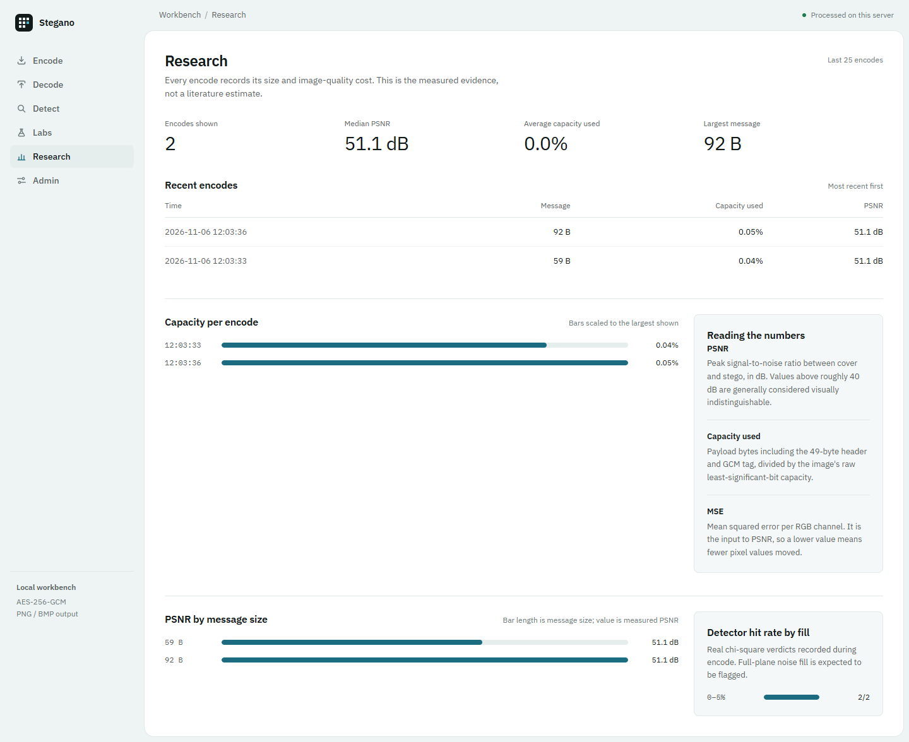

# Stegano — Image Steganography with AES-GCM

**Live demo:** https://stegano-two.vercel.app

Minor project: hide an encrypted message inside the pixels of a PNG or BMP image,
extract it again with the right password, measure how visible the change is, and run a
chi-square detector against your own output.

## What it does

- **Password-keyed scatter** — no sequential payload. Header and ciphertext bits are
  written to channel positions sampled from a keyed SHAKE stream, so the password
  decides where every bit lives.
- **No magic bytes** — there is no `STEG1` signature. The header position is derived
  from the password, and a wrong password fails the GCM authentication tag.
- **LSB matching** — instead of overwriting the lowest bit, the channel value moves by
  at most one (±1). Unused low bits are filled with random noise so the whole LSB plane
  looks touched.
- **Encryption** — scrypt (N=2¹⁴, r=8, p=1) stretches the password, HKDF derives a
  per-image key and scatter seed, and AES-256-GCM seals the payload with a random nonce.
- **Optional compression** — zlib runs before encryption when it makes the payload
  smaller; a flag byte tells the decoder to decompress.
- **Formats and interfaces** — PNG and BMP output, Python library, CLI, and a
  server-rendered web app.
- **Detector** — a chi-square LSB-pair test plus a legacy `STEG1` header scan, with a
  before/after self-test on the same upload.
- **Visual evidence** — amplified difference map and a before/after slider on every
  encode, PSNR and detector charts on the research dashboard.
- **Admin panel** — password login, rate limiting, and feature toggles
  for embedding, extraction, detector, diff/slider, noise fill, metrics, and research.


## Project layout

```
stegno-minor/
├── steg/
│   ├── core.py        v2 scatter embed/extract + AES-GCM payload format
│   ├── analysis.py    chi-square detector and legacy header scan
│   ├── metrics.py     MSE and PSNR
│   ├── features.py    persistent feature flags
│   ├── cli.py         encode / decode / detect / metrics commands
│   └── web.py         FastAPI app, detector, admin panel, research dashboard
├── tests/             core, analysis, flags, and web tests
├── docs/screenshots/  captured from the running app
├── index.py           Vercel entrypoint
├── vercel.json        Vercel function config
├── requirements.txt
├── run.ps1            one-command Windows start
├── LICENSE            MIT
└── README.md
```

## Setup (Windows)

```powershell
cd C:\Users\dhruv\stegno-minor
python -m venv .venv
.\.venv\Scripts\Activate.ps1
pip install -r requirements.txt
```

Python 3.11+ is required (tested on 3.15).

## Web app

```powershell
.\run.ps1
# if PowerShell blocks the script:
powershell -ExecutionPolicy Bypass -File .\run.ps1
# or
.\.venv\Scripts\python -m uvicorn steg.web:app --reload
```

Open http://127.0.0.1:8000.

Set the admin password before starting the server:

```powershell
$env:ADMIN_PASSWORD = "choose-a-long-random-string"
```

Five failed logins from one address lock that login for 60 seconds (per process).

- `/` — upload a cover, type a message and password, choose PNG/BMP, download the result.
  Shows live capacity, drag-and-drop, password strength, a before/after slider, and an
  amplified difference map.
- `/decode` — upload the stego image and password to read the message.
- `/detect` — run the chi-square test. Add a test message and password to embed in
  memory and compare the original and stego image side by side.
- `/research` — KPIs, capacity chart, PSNR-by-message-size chart, detector hit rate by
  fill bucket, and recent encodes.
- `/admin` — password login, feature toggles, upload limit.

**Do not resize, screenshot, or convert the output to JPEG** — all of those destroy the
least significant bits. Download the PNG or BMP and upload that exact file.


## Deploy on Vercel

The repo includes `index.py` and `vercel.json` for Vercel's zero-config FastAPI
runtime, and the live demo runs at https://stegano-two.vercel.app.

Set `ADMIN_PASSWORD` in the project's Production environment variables. Serverless
instances can only write to `/tmp`, so feature flags and research history are
per-instance and reset on cold starts. The download button inlines the image as a data
URL because function instances do not share files, and Vercel's 4.5 MB request limit
caps uploads below the admin setting.

## CLI

```powershell
# Encode (password is prompted, not echoed)
python -m steg.cli encode cover.png -m "meet me at 5" -o stego.png

# BMP output
python -m steg.cli encode cover.png -m "meet me at 5" --format bmp -o stego.bmp

# Decode to stdout
python -m steg.cli decode stego.png

# Binary payloads / saving to a file
python -m steg.cli encode cover.png -f secret.zip -p "password" -o stego.png
python -m steg.cli decode stego.png -p "password" -o secret.zip

# Chi-square detector and legacy header scan
python -m steg.cli detect stego.png

# Compare cover and stego (MSE, PSNR, capacity)
python -m steg.cli metrics cover.png stego.png
```

## Payload format (v2)

No bytes are written in sequence. A keyed sample of RGB channel positions carries the
header first, then a separate keyed sample carries the ciphertext:

| Field | Size | Purpose |
|---|---|---|
| scrypt salt | 16 B | Refines the password-derived master key per image |
| Nonce | 12 B | AES-GCM nonce |
| Ciphertext length | 4 B | Big-endian length of the compressed blob + tag |
| Flags | 1 B | Bit 0 = zlib-compressed |
| Ciphertext + tag | length + 16 B | Encrypted payload and GCM authentication tag |

Fixed overhead is 49 B, so an image with `capacity_bytes` raw LSB capacity fits
`capacity_bytes - 49` bytes of compressed payload. Header and body positions are
sampled without replacement from the same keyed stream family, and the body sample
excludes header positions.

## Measured results

All rows below were produced by this project on the same 400×300 cover (45,000 B of raw
capacity). Reproduce them with `python -m steg.cli detect` and the web dashboard.

| Experiment | PSNR | Capacity used | Legacy header | χ² p-value | Detector |
|---|---|---|---|---|---|
| Original cover | — | — | no | 0.0 | not flagged |
| v1 sequential replacement, 30 KB, `STEG1` | — | 66.7% | **yes** | 0.0 | **flagged** |
| v2 scatter + matching, 30 KB, noise off | 70.45 dB | 1.16% | no | 0.0 | not flagged |
| v2 scatter + matching, 30 KB, noise on | 51.13 dB | 1.16% | no | 0.0009 | not flagged |
| Full-plane LSB replacement | — | 100% | no | 0.083 | **flagged** |

What this shows, without overclaiming:

- The old format is caught by its `STEG1` header even before chi-square.
- v2 removes the signature and sequential layout; the pair-equality test did not flag
  the v2 samples.
- **Noise fill costs about 19 dB** at this size because it modifies every unused low
  bit. It buys a uniformly touched LSB plane, not undetectability.
- A chi-square detector with a 0.05 screening threshold will also flag naturally
  pair-balanced images (false positives). One p-value is evidence, not proof.
- LSB matching is still fragile: JPEG, resizing, or screenshots destroy the payload.



## Research metrics

- **MSE** — mean squared error per RGB channel between cover and stego.
- **PSNR** — `10 * log10(255² / MSE)`, in dB. Higher is better; above ~40 dB is
  generally considered visually indistinguishable.
- **Capacity used** — payload bytes / raw LSB capacity.
- **χ² p-value** — upper-tail probability for the even/odd LSB-pair test. Above 0.05 is
  flagged as replacement-style uniformity.

The dashboard records real encode values in `data/history.jsonl`; the detector result
is stored alongside each encode when the detector feature is enabled.

### Technique comparison

The table below is **literature context, not measurements from this project**.

| Technique | Capacity | Robustness | Typical visual quality | Complexity |
|---|---|---|---|---|
| LSB (this project) | High (~12.5% of raw bytes) | Very low — destroyed by JPEG/resize | High (> 50 dB at low fill) | Low |
| DCT / JPEG coefficients | Medium | Medium — survives JPEG to a degree | ~40–45 dB | High |
| Spread spectrum | Low | High — survives noise/cropping | ~40–45 dB | High |

Typical ranges adapted from Cheddad et al., *Digital image steganography: Survey and
analysis of current methods* (Signal Processing, 2010). Cite the original paper in your
report, not this README.

## Security and limitations

- **Encryption is real; undetectability is not claimed.** v2 removes the magic and
  sequential layout, and LSB matching avoids the strong pair equalisation of
  replacement. Full-plane noise fill is still a statistical signal, and a determined
  analyst with the right detector can find evidence of modification.
- **Not implemented:** adaptive embedding, Reed–Solomon ECC, decoy messages, WAV audio,
  and JPEG/DCT hiding. They are listed as future work rather than half-built features.
- **Fragile by design.** Any lossy transform destroys the payload.
- **Password strength matters.** scrypt slows guessing, but a weak password is still
  weak. Use a long passphrase.
- **Admin auth** — password compared in constant time, hashed session cookie
  (HttpOnly, SameSite=Lax), 5 failures per 60 s per IP. Set a strong
  `ADMIN_PASSWORD` before exposing the app.
- **Uploads** are capped (default 10 MB, configurable 1–50 MB) and parsed by Pillow;
  malformed files return a 400 instead of a traceback.
- Alpha channels are dropped (images are converted to RGB).

## Tests

```powershell
.\.venv\Scripts\python -m pytest -q
```

36 tests cover text/binary/compressed round trips, BMP output, wrong passwords,
capacity overflow, corrupt files, scatter/no-magic checks, chi-square and legacy
detection, flag validation/persistence, web encode/decode, upload limits, admin
password login, rate limiting, feature gating, detector pages, research history, and
path-traversal-safe downloads.

## What to demonstrate in a viva

1. Encode a message, download the PNG, decode it, then show a wrong password failing.
2. Drag the before/after slider and point at the amplified difference map.
3. Run `/detect` on the cover, then add a test message and show the before/after p-values
   and the `STEG1` legacy scan.
4. Show PSNR and detector charts on `/research`; explain the noise-fill trade-off.
5. Encode the same message as BMP and decode it.
6. Turn off the decode feature in `/admin`, show `/decode` blocked, and explain the
   5-failures-per-minute login limit.
7. Re-save a stego PNG as JPEG and show decoding fail, motivating the robustness
   discussion.

## License

MIT © 2026 Dhruv Gulia. See [LICENSE](LICENSE).
