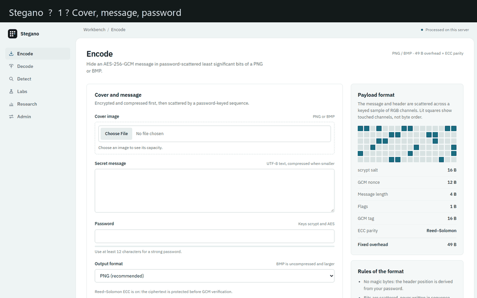
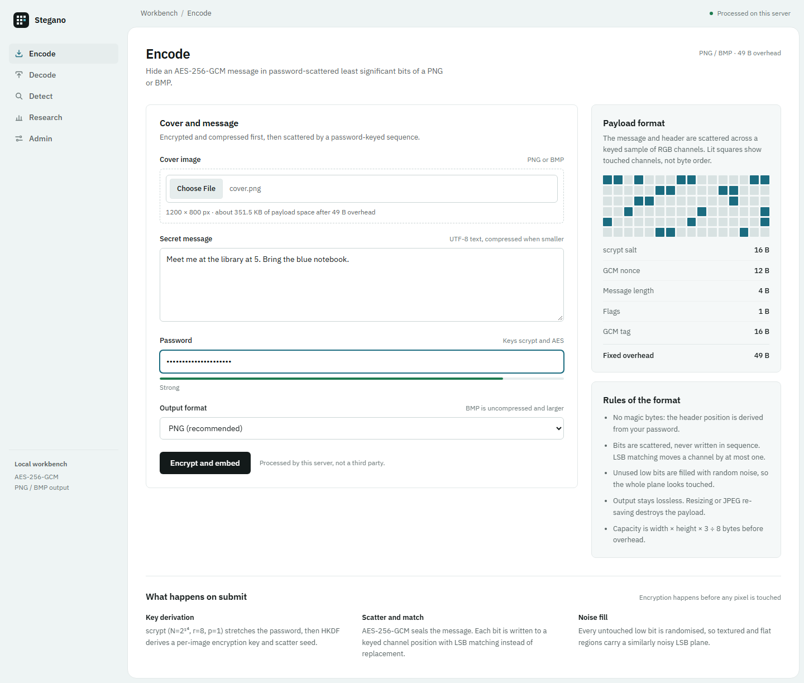
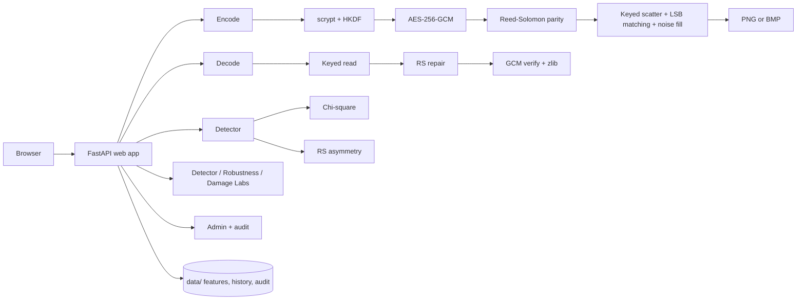
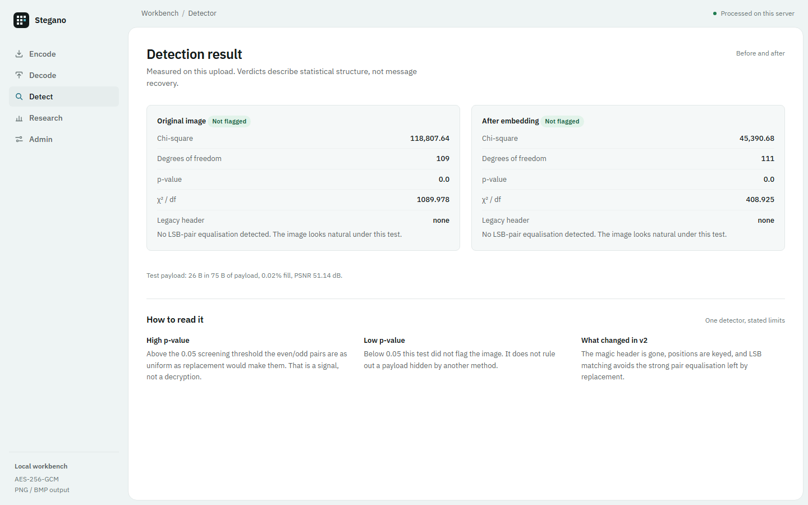
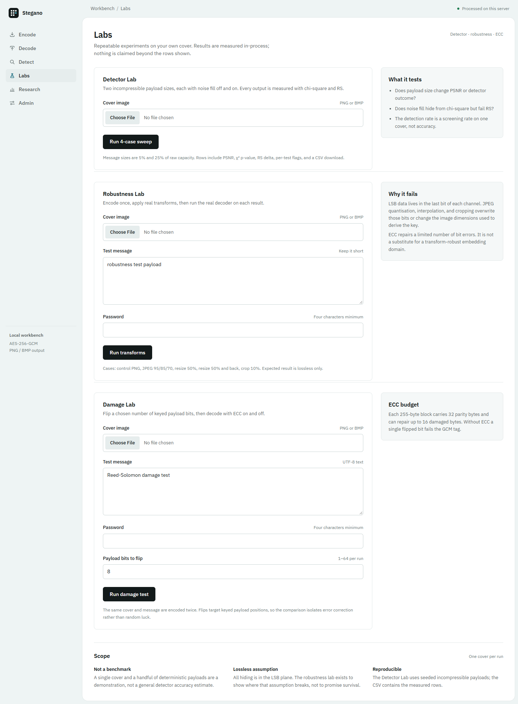

# Stegano — Image Steganography with AES-GCM

**Live demo:** https://stegano-two.vercel.app

[](https://github.com/dhruv-gulia/stegano/actions/workflows/ci.yml)

[](LICENSE)
[](https://stegano-two.vercel.app)

Minor project: hide an encrypted message inside the pixels of a PNG or BMP image,
recover it with the right password, measure the visual cost, and run honest
steganalysis against the result. The app includes a detector lab, a robustness lab,
Reed–Solomon error correction, and an audited admin panel.



## What it does

- **Password-keyed scatter** — no sequential payload. Header and ciphertext bits are
  written to channel positions sampled from a keyed SHAKE stream, so the password
  decides where every bit lives.
- **No magic bytes** — there is no `STEG1` signature. The header position is derived
  from the password, and a wrong password fails the GCM authentication tag.
- **LSB matching** — instead of overwriting the lowest bit, the channel value moves by
  at most one (±1). Unused low bits can be filled with random noise so the whole LSB
  plane looks touched.
- **Encryption** — scrypt (N=2¹⁴, r=8, p=1) stretches the password, HKDF derives a
  per-image key and scatter seed, and AES-256-GCM seals the payload with a random nonce.
- **Reed–Solomon ECC** — parity is added after GCM encryption and before scattering.
  The decoder repairs limited bit damage before GCM verification; unrepaired damage
  still fails closed.
- **Optional compression** — zlib runs before encryption when it makes the payload
  smaller; a flag byte tells the decoder to decompress.
- **Two detectors** — chi-square LSB-pair screening plus RS (regular/singular)
  asymmetry, with a before/after self-test on the same upload.
- **Detector Lab** — a seeded sweep over two payload sizes and noise fill off/on, with
  PSNR, chi-square p-values, RS delta, per-test flags, detection rate, and CSV export.
- **Robustness Lab** — encode once, then run the real decoder on JPEG 95/85/70, resize
  50%, resize and restore, and a 10% crop, with a lossless control.
- **Damage Lab** — flip keyed payload bits and compare ECC on/off treatment directly.
- **Research dashboard** — encode history, capacity bars, PSNR-by-size, and detector hit
  rate by fill bucket.
- **Admin panel** — password login, rate limiting, 11 feature toggles, and an audit log
  with CSV export for logins, flag changes, encodes, and lab runs.
- **Visual evidence** — animated v1-vs-v2 scatter explainer, amplified difference map,
  and a before/after slider on every encode.



## Architecture



## Project layout

```
stegno-minor/
├── steg/
│   ├── core.py        scatter embed/extract, AES-GCM, ECC, damage helper
│   ├── analysis.py    chi-square, RS analysis, legacy header scan
│   ├── labs.py        detector / robustness / damage experiment runners
│   ├── metrics.py     MSE and PSNR
│   ├── features.py    persistent feature flags
│   ├── cli.py         encode / decode / detect / metrics commands
│   └── web.py         FastAPI app, labs, admin, research dashboard
├── tests/             49 core, analysis, labs, flags, and web tests
├── docs/
│   ├── demo.gif       walkthrough GIF built from the screenshots
│   ├── cover.png      demo landscape
│   └── screenshots/   encode, result, detect, labs, damage, research, admin
├── .github/workflows/ci.yml
├── index.py           Vercel entrypoint
├── vercel.json        Vercel function config
├── requirements.txt
├── run.ps1            one-command Windows start
├── SECURITY.md
├── LICENSE            MIT
└── README.md
```

## Setup (Windows)

```powershell
cd C:\Users\dhruv\stegno-minor
python -m venv .venv
.\.venv\Scripts\Activate.ps1
pip install -r requirements.txt
```

Python 3.11+ is required.

## Web app

```powershell
.\run.ps1
# if PowerShell blocks the script:
powershell -ExecutionPolicy Bypass -File .\run.ps1
# or
.\.venv\Scripts\python -m uvicorn steg.web:app --reload
```

Open http://127.0.0.1:8000.

Set the admin password before starting the server:

```powershell
$env:ADMIN_PASSWORD = "choose-a-long-random-string"
```

Five failed logins from one address lock that login for 60 seconds (per process).

- `/` — upload a cover, type a message and password, choose PNG/BMP, download the result.
  Shows live capacity, drag-and-drop, password strength, ECC status, a before/after
  slider, and an amplified difference map.
- `/decode` — upload the stego image and password to read the message.
- `/detect` — run chi-square, RS, and legacy-header analysis. Add a test message and
  password to embed in memory and compare the original and stego image side by side.
- `/lab` — Detector Lab, Robustness Lab, and Damage Lab, each with CSV export.
- `/research` — KPIs, capacity chart, PSNR-by-message-size chart, detector hit rate by
  fill bucket, and recent encodes.
- `/admin` — password login, feature toggles, upload limit, and the audit log.

**Do not resize, screenshot, or convert the output to JPEG** — all of those destroy the
least significant bits. Download the PNG or BMP and upload that exact file.



## Deploy on Vercel

The repo includes `index.py` and `vercel.json` for Vercel's zero-config FastAPI
runtime, and the live demo runs at https://stegano-two.vercel.app. Every push to `main`
runs the tests and then deploys production through `.github/workflows/ci.yml`, using the
`VERCEL_TOKEN` repository secret.

Set `ADMIN_PASSWORD` in the project's Production environment variables. Serverless
instances can only write to `/tmp`, so feature flags, research history, and the audit
log are per-instance and reset on cold starts. The download button inlines the image as
a data URL because function instances do not share files, and Vercel's 4.5 MB request
limit caps uploads below the admin setting.

## CLI

```powershell
# Encode (password is prompted, not echoed)
python -m steg.cli encode cover.png -m "meet me at 5" -o stego.png

# BMP output
python -m steg.cli encode cover.png -m "meet me at 5" --format bmp -o stego.bmp

# Decode to stdout
python -m steg.cli decode stego.png

# Binary payloads / saving to a file
python -m steg.cli encode cover.png -f secret.zip -p "password" -o stego.png
python -m steg.cli decode stego.png -p "password" -o secret.zip

# Chi-square + RS detector and legacy header scan
python -m steg.cli detect stego.png

# Compare cover and stego (MSE, PSNR, capacity)
python -m steg.cli metrics cover.png stego.png
```

## Payload format (v2)

No bytes are written in sequence. A keyed sample of RGB channel positions carries the
header first, then a separate keyed sample carries the protected body:

| Field | Size | Purpose |
|---|---|---|
| scrypt salt | 16 B | Refines the password-derived master key per image |
| Nonce | 12 B | AES-GCM nonce |
| Payload length | 4 B | Big-endian length of the compressed blob |
| Flags | 1 B | Bit 0 = zlib-compressed; bit 1 = Reed–Solomon ECC |
| Ciphertext + tag | length + 16 B | AES-256-GCM ciphertext and authentication tag |
| ECC parity | variable | 32 parity bytes per 223-byte body block |

The fixed header and tag are 49 B. With ECC on, each 223-byte block of ciphertext+tag
becomes a 255-byte codeword; up to 16 damaged bytes per block can be repaired before
GCM verifies the payload. Header and body positions are sampled without replacement
from the same keyed stream family, and the body sample excludes header positions.

## Measured results

One representative run on the same 400×300 cover (45,000 B of raw capacity). Salts,
scatter positions, and payload bytes are random, so exact detector values move between
runs. Reproduce with the CLI, `/detect`, and `/lab`.

| Experiment | PSNR | Capacity used | ECC parity | χ² p-value | RS delta | Result |
|---|---|---|---|---|---|---|
| Original cover | — | — | — | 0.0 | 0.0122 | not flagged |
| v1 sequential replacement, 30 KB, `STEG1` | — | 66.7% | none | 0.0 | 0.0179 | **flagged by header** |
| v2 scatter, 500 B, ECC off, noise off | 70.32 dB | 1.22% | 0 B | 0.0 | 0.0136 | not flagged |
| v2 scatter, 500 B, ECC off, noise on | 51.14 dB | 1.22% | 0 B | 0.0041 | 0.0111 | not flagged |
| v2 scatter, 30 KB, ECC off, noise off | 52.90 dB | 66.78% | 0 B | 0.0 | 0.0004 | not flagged |
| v2 scatter, 30 KB, ECC off, noise on | 51.14 dB | 66.78% | 0 B | 0.0001 | 0.0013 | not flagged |
| v2 scatter, 30 KB, ECC on, noise off | 52.31 dB | 76.38% | 4,320 B | 0.0 | 0.0013 | not flagged |
| Full-plane LSB replacement | — | 100% | none | 0.0833 | 0.0224 | **flagged** |

A separate Detector Lab sweep on the 1,200×800 `docs/cover.png` (18,000 B and 90,000 B
payloads, noise off/on, ECC on) produced **3 of 4 rows flagged**. Chi-square stayed at
p = 0.0 in every row; RS caught both noise-on rows and the largest noise-off row
(delta 0.022–0.033). That is the point of adding a second detector: the tests fail
differently.

The Damage Lab encoded the same message twice, flipped **8 keyed payload bits** in each
copy, and decoded both. The ECC copy repaired 6 bytes and returned the message; the
non-ECC copy failed the GCM tag. This is targeted payload damage, not random-pixel luck.

What this shows, without overclaiming:

- The old format is caught by its `STEG1` header even before chi-square.
- v2 removes the signature and sequential layout; the pair-equality test did not flag
  the v2 samples above.
- **Noise fill costs about 19 dB** at low fill because it modifies every unused low bit.
  It buys a uniformly touched LSB plane, not undetectability.
- RS can catch noise fill that chi-square misses. Neither detector proves a message is
  present or absent.
- ECC repairs limited bit damage, not JPEG, resizing, or cropping.
- LSB matching is still fragile: JPEG, resizing, or screenshots destroy the payload.



## Research metrics

- **MSE** — mean squared error per RGB channel between cover and stego.
- **PSNR** — `10 * log10(255² / MSE)`, in dB. Higher is better; above ~40 dB is
  generally considered visually indistinguishable.
- **Capacity used** — stored payload bytes (header, ciphertext, tag, and ECC parity)
  divided by raw LSB capacity.
- **χ² p-value** — upper-tail probability for the even/odd LSB-pair test. Above 0.05 is
  flagged as replacement-style uniformity.
- **RS delta** — `|R+ − R−| + |S+ − S−|` over groups of four luminance pixels. Above
  0.02 is flagged by this implementation as elevated regular/singular asymmetry.
- **Detection rate** — percentage of Detector Lab rows flagged by either test. It is a
  screening rate for that sample, not a benchmark.

The dashboard records real encode values in `data/history.jsonl`; the detector result
is stored alongside each encode when the detector feature is enabled.

### Technique comparison

The table below is **literature context, not measurements from this project**.

| Technique | Capacity | Robustness | Typical visual quality | Complexity |
|---|---|---|---|---|
| LSB (this project) | High (~12.5% of raw bytes) | Very low — destroyed by JPEG/resize | High (> 50 dB at low fill) | Low |
| DCT / JPEG coefficients | Medium | Medium — survives JPEG to a degree | ~40–45 dB | High |
| Spread spectrum | Low | High — survives noise/cropping | ~40–45 dB | High |

Typical ranges adapted from Cheddad et al., *Digital image steganography: Survey and
analysis of current methods* (Signal Processing, 2010).

## Security and limitations

- **Encryption is real; undetectability is not claimed.** v2 removes the magic and
  sequential layout, and LSB matching avoids the strong pair equalisation of
  replacement. Full-plane noise fill is still a statistical signal, and RS analysis can
  expose it on some covers.
- **ECC is not robustness.** Reed–Solomon corrects a bounded number of payload bit
  errors. It does not survive lossy transforms or dimension changes; see the Robustness
  Lab.
- **Not implemented:** adaptive embedding, decoy messages, WAV audio, and JPEG/DCT
  hiding. They are listed as future work rather than half-built features.
- **Admin auth** — password compared in constant time, hashed session cookie
  (HttpOnly, SameSite=Lax), 5 failures per 60 s per IP. Set a strong
  `ADMIN_PASSWORD` before exposing the app.
- **Audit log** — `data/audit.jsonl` records logins, flag changes, encodes, and lab runs
  without message text or passwords. On Vercel it is per-instance and ephemeral.
- **Uploads** are capped (default 10 MB, configurable 1–50 MB) and parsed by Pillow;
  malformed files return a 400 instead of a traceback.
- Alpha channels are dropped (images are converted to RGB).

See [SECURITY.md](SECURITY.md) for the threat model and reporting process.

## Tests and CI

```powershell
.\.venv\Scripts\python -m pytest -q
```

49 tests cover text/binary/compressed round trips, BMP output, wrong passwords, capacity
overflow, ECC round trips and targeted damage, corrupt files, scatter/no-magic checks,
chi-square and RS analysis, flag validation/persistence, web encode/decode, upload
limits, admin login/rate limiting, labs, audit logging and CSV export, feature gating,
research history, and path-traversal-safe downloads.

GitHub Actions runs the same suite on Python 3.12 for every push to `main` and every
pull request, then deploys production on `main` after the tests pass.

## What to demonstrate in a viva

1. Encode a message, download the PNG, decode it, then show a wrong password failing.
2. Drag the before/after slider and point at the amplified difference map.
3. Run `/detect` on the cover, then add a test message and show chi-square versus RS.
4. Open `/lab`, run the Detector Lab, and explain why noise fill lowers PSNR and why RS
   and chi-square disagree.
5. Run the Damage Lab: ECC on recovers, ECC off fails the GCM tag.
6. Run the Robustness Lab and show that only the lossless control survives.
7. Show PSNR and detector charts on `/research`; explain the noise-fill trade-off.
8. Turn off a feature in `/admin`, show that surface returning 403, then open the audit
   log and download its CSV.
9. Encode the same message as BMP and decode it.

## References

- A. Westfeld and A. Pfitzmann, “Attacks on Steganographic Systems,” *Information
  Hiding*, 1999 — chi-square LSB-pair analysis.
- J. Fridrich, M. Goljan, and R. Du, “Reliable Detection of LSB Steganography in Color
  and Grayscale Images,” *IEEE Multimedia*, 2001 — RS analysis.
- I. S. Reed and G. Solomon, “Polynomial Codes over Certain Finite Fields,” *Journal of
  the Society for Industrial and Applied Mathematics*, 1960.
- A. Cheddad, J. Condell, K. Curran, and P. Mc Kevitt, “Digital image steganography:
  Survey and analysis of current methods,” *Signal Processing*, 2010.

## License

MIT © 2026 Dhruv Gulia. See [LICENSE](LICENSE).
